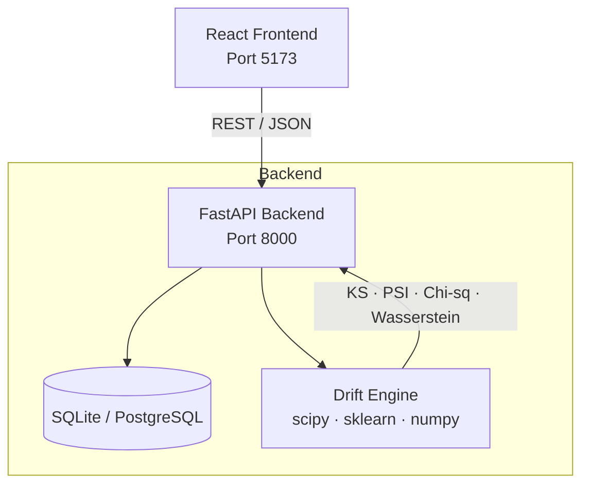

<div align="center">

# PulseML

**Production ML Model Monitoring & Drift Detection Platform**

[](https://github.com/your-username/pulseml/actions)
[](https://python.org)
[](https://fastapi.tiangolo.com)
[](https://react.dev)
[](LICENSE)

[Live Demo](#quick-start) · [API Docs](#api-documentation) · [Architecture](#architecture)

</div>

---

## What is PulseML?

PulseML detects when your deployed ML models start to fail — before your users notice.

It watches for three types of drift:

| Type | What it catches | Algorithm |
|---|---|---|
| **Data drift** | Input feature distributions shifting | KS test, Wasserstein distance |
| **Prediction drift** | Score/output distribution shifting | PSI, Chi-squared |
| **Performance drift** | Accuracy / AUC / F1 degrading | Statistical threshold monitoring |

---

## Features

- **Model Registry** — register models with metadata, version, and feature names
- **Prediction Log Upload** — upload batched prediction windows via REST API
- **Automatic Drift Analysis** — runs on every new window; no manual trigger needed
- **Statistical Algorithms** — KS test, PSI, Chi-squared, Wasserstein distance
- **Alert System** — severity-graded alerts (low / medium / high) with one-click resolve
- **Interactive Dashboard** — drift timeline chart, prediction distribution comparison
- **REST API** — full OpenAPI spec at `/api/docs`
- **Sample Data Generator** — 6-month credit-risk demo with injected drift
- **Docker Ready** — single `docker-compose up` to run everything

---

## Architecture



### Data Flow

```
Upload predictions  →  Compute stats  →  Store log
        ↓
  Auto-trigger drift  →  Run algorithms  →  Store report
        ↓
  Generate alerts  →  Notify dashboard
```

---

## Tech Stack

| Layer | Technology |
|---|---|
| Backend | Python 3.11, FastAPI, SQLAlchemy 2, Pydantic v2 |
| Drift Engine | scipy (KS, Chi-sq, Wasserstein), numpy, scikit-learn |
| Frontend | React 18, TypeScript, Vite, Tailwind CSS, Recharts |
| Database | SQLite (dev) / PostgreSQL (prod) |
| Testing | pytest, httpx (28 tests) |
| DevOps | Docker, docker-compose, GitHub Actions |

---

## Quick Start

### Option A — Local (recommended for development)

```bash
# 1. Clone
git clone https://github.com/your-username/pulseml.git
cd pulseml

# 2. Backend
python -m venv venv
source venv/bin/activate          # Windows: venv\Scripts\activate
pip install -r requirements.txt
cp .env.example .env
python scripts/init_db.py
uvicorn backend.main:app --reload --port 8000

# 3. Frontend (new terminal)
cd frontend
npm install
npm run dev
```

Open **http://localhost:5173**

### Option B — Docker

```bash
cp .env.example .env
docker-compose up --build
```

Backend: http://localhost:8000/api/docs  
Frontend: http://localhost:5173

---

## Load Sample Data

```bash
# Generate + upload 6 monthly batches (requires backend running)
python scripts/load_sample.py

# Or generate data only (no backend needed)
python data/sample/generate_sample.py
```

This registers a **credit-risk scoring model** and uploads 6 monthly prediction batches with realistic drift injected from batch 4 onwards. You'll see warnings in batch 4–5 and a critical alert in batch 6.

---

## API Documentation

Interactive docs: **http://localhost:8000/api/docs**

### Core Endpoints

```
GET  /api/health                                   Health check
GET  /api/dashboard                                Full dashboard summary

POST /api/models/                                  Register model
GET  /api/models/                                  List models
GET  /api/models/{id}                              Get model
PATCH /api/models/{id}                             Update model
DELETE /api/models/{id}                            Delete model

POST /api/models/{id}/logs/                        Upload prediction log
GET  /api/models/{id}/logs/                        List logs

POST /api/models/{id}/drift?reference=X&target=Y  Trigger drift analysis
GET  /api/models/{id}/drift                        List drift reports

GET  /api/models/{id}/alerts                       Model alerts
GET  /api/alerts                                   All alerts
PATCH /api/alerts/{id}/resolve                     Resolve alert
```

### Upload a Prediction Log

```bash
curl -X POST http://localhost:8000/api/models/{MODEL_ID}/logs/ \
  -H "Content-Type: application/json" \
  -d '{
    "window_label": "2024-07",
    "predictions": [0.92, 0.14, 0.78, 0.33],
    "labels": [1, 0, 1, 0],
    "features": {
      "age":    [45, 23, 67, 31],
      "income": [75000, 28000, 95000, 42000]
    }
  }'
```

---

## Running Tests

```bash
# All tests
pytest tests/ -v

# Unit tests only (drift algorithms)
pytest tests/test_drift_detectors.py -v

# API integration tests
pytest tests/test_api.py -v
```

**Test results: 28/28 passing**

```
tests/test_drift_detectors.py  ....  15 passed
tests/test_api.py              ....  13 passed
```

---

## Configuration

All settings via environment variables (see `.env.example`):

| Variable | Default | Description |
|---|---|---|
| `DATABASE_URL` | `sqlite:///./data/pulseml.db` | Database connection string |
| `SECRET_KEY` | — | Required in production |
| `KS_DRIFT_THRESHOLD` | `0.1` | KS statistic threshold for drift flag |
| `PSI_DRIFT_THRESHOLD` | `0.2` | PSI threshold (>0.2 = significant drift) |
| `PERFORMANCE_DROP_THRESHOLD` | `0.05` | Relative metric drop to trigger alert |
| `MIN_SAMPLES` | `50` | Minimum samples for drift analysis |

---

## Project Structure

```
pulseml/
├── backend/
│   ├── main.py              # FastAPI app + lifespan
│   ├── config.py            # Settings from env
│   ├── database.py          # SQLAlchemy engine + session
│   ├── models/orm.py        # Database models
│   ├── schemas/schemas.py   # Pydantic request/response schemas
│   ├── routers/             # API route handlers
│   ├── services/            # Business logic (drift, alerts)
│   └── ml_engine/           # Drift detection algorithms + metrics
├── frontend/src/
│   ├── App.tsx              # Router
│   ├── api/client.ts        # Axios API client
│   ├── components/          # Shared UI components
│   ├── pages/               # Dashboard, Models, ModelDetail, Alerts, Upload
│   └── types/               # TypeScript interfaces
├── tests/                   # 28 pytest tests
├── data/sample/             # Sample data generator
├── scripts/                 # DB init + sample loader
└── .github/workflows/ci.yml # GitHub Actions
```

---

## Future Improvements

- [ ] PostgreSQL support with Alembic migrations
- [ ] Multi-variate drift detection (covariate shift)
- [ ] Webhook / Slack / email notifications on critical alerts
- [ ] Model explainability integration (SHAP values)
- [ ] Time-series anomaly detection for metrics
- [ ] User authentication (JWT)
- [ ] Batch drift comparison across multiple windows
- [ ] Export reports as PDF

---

## License

MIT — see [LICENSE](LICENSE)

---

## Author

Built by **Mandeep** · B.Tech AI & DS · IIIT Raichur · DeepLabs Research Group
